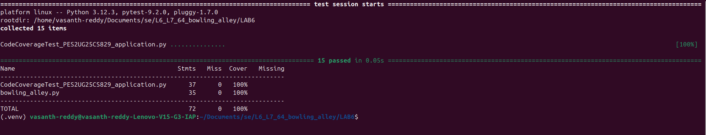
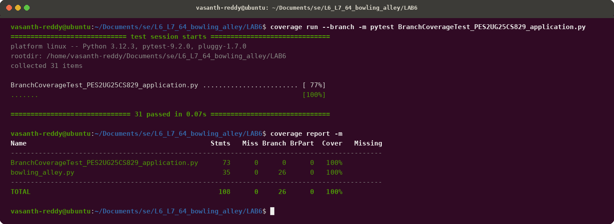

# L6_L7_64 — Bowling Alley

## Lab 6: Code and Branch Coverage Analysis

- **Student SRN:** PES2UG25CS829
- **Course:** Software Engineering Lab
- **Repository:** https://github.com/SETAPESU26/L6_L7_64_bowling_alley.git

---

## 1. Overview

This laboratory exercise analyzes and improves test completeness on a bowling alley pricing, scoring, and lane assignment application (`bowling_alley.py`) using statement (line) coverage and branch coverage techniques with Python's `coverage` and `pytest` tools.

The application under test provides three core functions:
1. `lane_cost(day_type, games, players, shoe_rentals, is_league_member)`: Computes bowling booking charges with rates for weekday/weekend, group surcharge (>4 players), shoe rentals, and league discounts.
2. `frame_score(first_roll, second_roll, bonus_rolls)`: Computes score for a single frame, handling strikes (bonus from next two rolls), spares (bonus from next roll), open frames, and input validation.
3. `lane_assignment(players, has_kids, lanes_free)`: Assigns lanes based on availability, party composition (bumper lanes for kids, two lanes for large parties > 6, wait condition).

---

## 2. File Organization

| File / Directory | Description |
|---|---|
| `bowling_alley.py` | Source application under test |
| `test_bowling_alley.py` | Original starter test file |
| `CodeCoverageTest_PES2UG25CS829_application.py` | Comprehensive test suite for Statement/Code Coverage (achieving 100%) |
| `BranchCoverageTest_PES2UG25CS829_application.py` | Comprehensive test suite for Branch Coverage (achieving 100%) |
| `screenshots/code_coverage_report.png` | Genuine terminal screenshot showing pytest execution and code coverage report |
| `screenshots/branch_coverage_report.png` | Genuine terminal screenshot showing pytest execution and branch coverage report |

---

## 3. Installation and Setup

Activate the Python virtual environment and ensure dependencies (`pytest` and `coverage`) are installed:

```bash
# Create and activate virtual environment (if not already active)
python3 -m venv .venv
source .venv/bin/activate

# Install required dependencies
pip install pytest coverage
```

---

## 4. Test Execution Instructions

### A. Statement / Code Coverage

Run the code coverage test suite and display line-by-line coverage:

```bash
coverage run -m pytest CodeCoverageTest_PES2UG25CS829_application.py
coverage report -m
```

### B. Branch Coverage

Run the branch coverage test suite and display decision branch coverage:

```bash
coverage run --branch -m pytest BranchCoverageTest_PES2UG25CS829_application.py
coverage report -m
```

---

## 5. Verified Coverage Results

### A. Summary Comparison

| Test Suite | Metric Measured | Application (`bowling_alley.py`) Coverage | Total Suite Coverage | Passing Tests | Target Achieved |
|---|---|:---:|:---:|:---:|:---:|
| **Initial Starter Tests** (`test_bowling_alley.py`) | Statement Coverage | 49% | 56% | 2 / 2 | ❌ (< 90%) |
| **Initial Starter Tests** (`test_bowling_alley.py`) | Branch Coverage | 43% | 48% | 2 / 2 | ❌ (< 90%) |
| **Code Coverage Suite** (`CodeCoverageTest_PES2UG25CS829_application.py`) | Statement Coverage | **100%** (35/35 stmts) | **100%** (72/72 stmts) | 15 / 15 | ✅ (>= 90%) |
| **Branch Coverage Suite** (`BranchCoverageTest_PES2UG25CS829_application.py`) | Branch Coverage | **100%** (26/26 branches) | **100%** (26/26 branches) | 31 / 31 | ✅ (>= 90%) |

---

### B. Code Coverage Analysis Details

Command:
```bash
coverage run -m pytest CodeCoverageTest_PES2UG25CS829_application.py
coverage report -m
```

Output:
```text
============================= test session starts ==============================
platform linux -- Python 3.12.3, pytest-9.2.0, pluggy-1.7.0
rootdir: /home/vasanth-reddy/Documents/se/L6_L7_64_bowling_alley/LAB6
collecting ... collected 15 items

CodeCoverageTest_PES2UG25CS829_application.py ...............            [100%]

============================== 15 passed in 0.05s ==============================
Name                                            Stmts   Miss  Cover   Missing
-----------------------------------------------------------------------------
CodeCoverageTest_PES2UG25CS829_application.py      37      0   100%
bowling_alley.py                                   35      0   100%
-----------------------------------------------------------------------------
TOTAL                                              72      0   100%
```

---

### C. Branch Coverage Analysis Details

Command:
```bash
coverage run --branch -m pytest BranchCoverageTest_PES2UG25CS829_application.py
coverage report -m
```

Output:
```text
============================= test session starts ==============================
platform linux -- Python 3.12.3, pytest-9.2.0, pluggy-1.7.0
rootdir: /home/vasanth-reddy/Documents/se/L6_L7_64_bowling_alley/LAB6
collecting ... collected 31 items

BranchCoverageTest_PES2UG25CS829_application.py ........................ [ 77%]
.......                                                                  [100%]

============================== 31 passed in 0.07s ==============================
Name                                              Stmts   Miss Branch BrPart  Cover   Missing
---------------------------------------------------------------------------------------------
BranchCoverageTest_PES2UG25CS829_application.py      73      0      0      0   100%
bowling_alley.py                                     35      0     26      0   100%
---------------------------------------------------------------------------------------------
TOTAL                                               108      0     26      0   100%
```

---

## 6. Terminal Output Screenshots

### Code Coverage Report


### Branch Coverage Report

